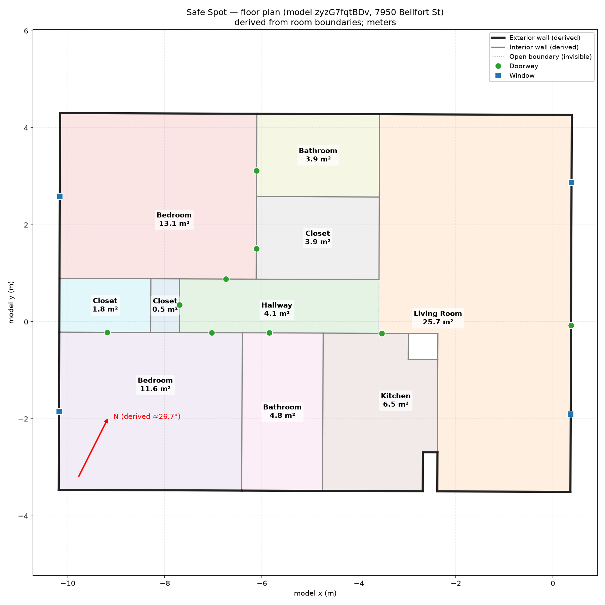
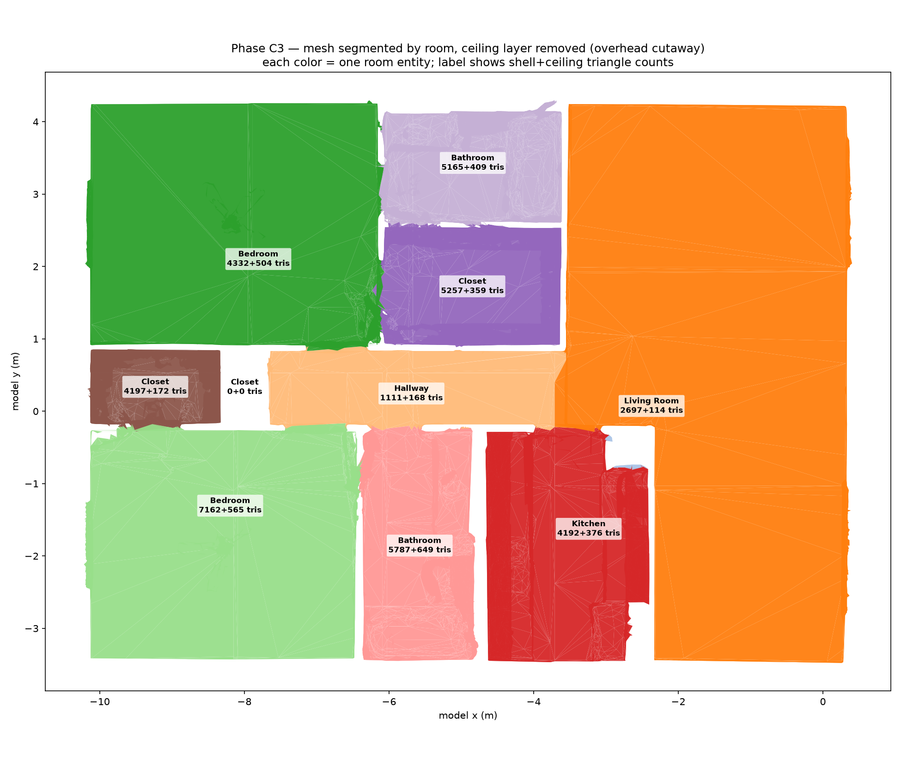
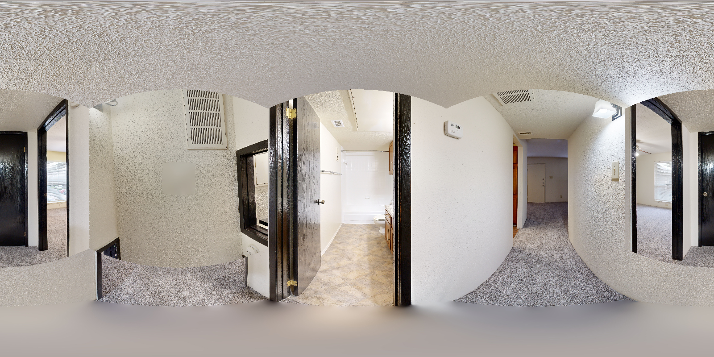
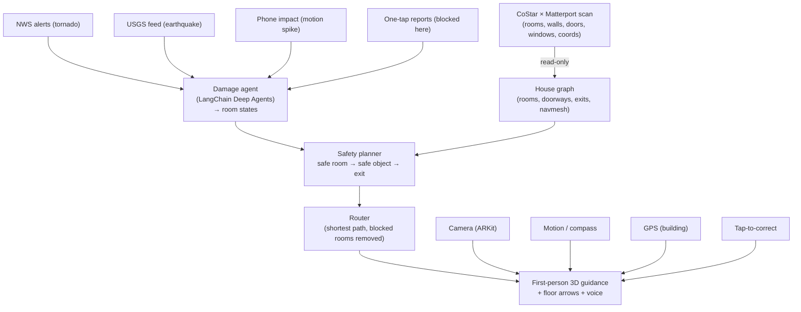

# Safe Spot

**When a disaster hits, no one should be stuck wondering where to go.**

You open Safe Spot on your phone, tap **Tornado**, **Earthquake**, or **Fire**, and it walks you — in first person, through a 3D scan of your own home — to the safest spot inside it. When a room is damaged, it reroutes.

Built at **HackPrinceton, Fall 2026.**

---

## Demo

**Demo video:** `<YOUTUBE_LINK>`

| | |
|---|---|
|  |  |
| Floor plan of the demo house (7950 Bellfort St, Houston) | Rooms derived from the Matterport scan |


*A 360° panorama (one per scan point) — these are what you stand inside in first-person view.*

> These are data/pipeline renders from the scan. The demo video shows the running app.

---

## The problem

When a tornado, hurricane, flood, or fire hits, people inside a building don't know where the safest spot is or how to get there — and the safest route **changes as the building gets damaged**. An address gets rescuers to the building, not to the right room.

Recent events (see `docs/DECISIONS.md` for sources):

- **2024 Houston derecho:** over 2,500 downtown high-rise windows damaged; towers designed for hurricane-strength winds still failed at cladding and windows.
- **Hurricane Beryl (2024):** 2.2 million customers lost power in extreme heat; most deaths were older adults stuck in homes and apartments.
- **2025 Los Angeles fires:** CoStar estimated ~11,200 properties destroyed and ~$30 billion in real-estate losses.
- **2023 Turkey earthquake:** trapped people shared addresses on social media, but an address doesn't tell rescuers the floor or room.

---

## Who it's for

**Target user:** residents and families in disaster-prone cities — including kids who have their own phones. The demo house is a real home in Houston.

**Next users:** building managers, hotels, hospitals, universities, and first responders.

---

## How it works (user flow)

1. Open the app inside your scanned home. It knows which room you're in.
2. Tap **Tornado**, **Earthquake**, or **Fire**.
3. A **first-person 3D route** appears — floor arrows and turn-by-turn instructions, with spoken guidance.
4. If a room is reported **blocked** (one tap, or a sensor/alert), the route **reroutes live** around it.
5. You arrive at the safe spot — or, in an earthquake, you're told to **take cover first** and move only after the shaking stops.

Ask out loud *"Where do I go next?"* and it answers from your current route.

---

## What's built

| Module | What it does | Status | Owner |
|---|---|---|---|
| `house` | Loads the read-only CoStar/Matterport scan into a room/doorway/exit graph and a 3D scene | **Working** | Harini |
| `guide` | First-person panorama view, route + instructions, floor arrows, voice in/out, scripted demo | **Working** | Harini |
| `locate` | Camera (ARKit) + motion + compass + GPS + tap fallback, snapped to the floor plan | **Working** (position is approximate on-device) | Sanjana |
| `hazard` | NWS tornado alerts + USGS earthquake feed | **Working** | Lavanya |
| `damage` | Turns alert text into validated room states (LangChain Deep Agents; one-tap/impact go deterministic) | **Working** | Lavanya |
| `planner` | Tornado / earthquake / fire rules with the fallback order | **Working** | Lavanya |
| `router` | Shortest path, blocked rooms removed; re-plans on every change | **Working** | Lavanya |
| `voice` | Answers "where do I go next?" from the current route state (deterministic; Deep Agents optional) | **Working** | Lavanya + Harini |
| API + WebSocket | `POST /plan /report /interpret /voice`; `WS /ws/plan /ws/sensors` | **Working** | Lavanya |
| Objects (furniture) | "Safe object" step (table, tub) — **no furniture in the scan**, so not built | **Planned** | — |
| Photoreal mesh | Textured mesh built but reads as raw photogrammetry; Tour ships panorama-only | **Partial** | Harini |

---

## Data

Source: **CoStar × Matterport** scan of **7950 Bellfort St, Houston, TX** (model `zyzG7fqtBDv`). Everything below is **read-only**; the app only reads it and adds navigation on top.

- **11 rooms**, **9 doorways**, **4 windows**, **1 exterior door**, **19 scan points** (one 360° panorama each), single floor.
- **50k-face textured mesh** (23,438 vertices).
- **Derived** (not edited into the source): interior vs. exterior walls (an edge shared by two rooms is interior; an edge in one room is exterior), doorway→room connectivity, and exterior exits.
- **Alignment check** (`docs/alignment.md`): mesh, room boundaries, and panoramas share one coordinate frame (meters, Z-up). Mesh↔room offset ≤ 16.4 cm in X / 2.9 cm in Y — within wall thickness, so the transform is the identity. **19/19 panoramas** fall inside their room polygon and sit above the floor.
- **No furniture/object annotations** exist in the scan (0 objects).

**Fetching the data:** the binary assets (mesh, panoramas) are time-limited Matterport CDN links, not committed. `scripts/fetch_assets.py` re-fetches them using `MATTERPORT_API_KEY` / `MATTERPORT_API_TOKEN` from a repo-root `.env` (see `backend/.env.example`).

---

## Architecture



---

## The AI agent and its guardrails

The design principle: **code does the math, the agent does the judgment.**

- **Code** (deterministic): position, geometry, routing, distances. These never go through a model.
- **The agent** (judgment): turns ambiguous hazard-alert text (NWS/USGS) into room states, and answers "where do I go next?" One-tap reports and phone-impact signals already carry an explicit state and skip the model entirely.

**Guardrails:**
- Every room id the agent emits is **validated against the real house graph** — unknown ids are dropped (CLAUDE.md rule 3).
- On any agent failure, the backend **falls back to the deterministic assignment**, and the app **keeps the last valid plan**. A flaky or slow model never breaks the flow.

**Model:** a provider-agnostic factory (`agents/model.py`) — **Ollama (local) is the default**; **Amazon Bedrock** and Gemini are supported by changing one env var. Bedrock runs once sponsor credentials are configured. The live voice path is deterministic by default (instant and always correct); the Deep Agents voice path is behind a flag.

---

## Safe-spot logic

| Hazard | Order |
|---|---|
| Tornado | Interior room, lowest floor, no windows, no outside walls → sturdy object nearby → exit |
| Earthquake | **Take cover where you are** (no running during shaking) → exit after it stops |
| Fire | Nearest exit whose path avoids the fire room and blocked rooms → second exit |

**Fallback order:** safe room → safe object → exit.

**What the demo house's data shows:** four rooms are fully interior (no windows, no exterior walls) — two closets, the hallway, and a small void. The practical tornado-safe interior spaces are the **~3.9 m² closet** and the **hallway**. The home has a **single exterior door**, which the fire logic routes toward. (The "safe object" step is limited because the scan has no furniture data.)

---

## Tech stack

- **iOS:** Swift, SwiftUI, RealityKit, ARKit, CoreMotion, CoreLocation, AVSpeech + Speech; `SafeSpotCore` local Swift package (pure logic).
- **Backend:** Python, FastAPI, WebSocket; **LangChain Deep Agents** for the damage agent; provider factory for Ollama / Bedrock / Gemini.
- **Feeds:** NWS API (`api.weather.gov`), USGS earthquake feed — both keyless HTTP.

---

## Setup and run

### iOS app
- Requires **Xcode 27.2** and a **real iPhone** (ARKit camera tracking and CoreMotion don't work in the Simulator).
- Open `ios/SafeSpot/SafeSpot.xcodeproj`, set the signing team to your Apple ID, and run on your iPhone.
- To reach the backend from the phone, copy `ios/SafeSpot/SafeSpot/Backend/BackendConfig.example.plist` → `BackendConfig.plist` (gitignored) and set `BaseURL` to the backend machine's LAN IP (e.g. `http://192.168.1.23:8000`). Both devices must be on the same Wi-Fi.
- For the most reliable demo, use the **▶︎ Demo** button in Tour mode — it needs no sensors, Wi-Fi, or backend.

### SafeSpotCore tests
```bash
cd ios/SafeSpotCore
swift test      # 30 tests
```

### Backend
```bash
cd backend
python3 -m venv .venv && source .venv/bin/activate
pip install -r requirements.txt
cp .env.example .env        # fill in keys as available (works on local Ollama with none)
uvicorn main:app --host 0.0.0.0 --port 8000
```
- `--host 0.0.0.0` is required so the iPhone can reach it (not `127.0.0.1`).
- `python check_access.py` verifies NWS / USGS / Bedrock access. `python e2e_check.py` runs an end-to-end check.

### Data
```bash
# with MATTERPORT_API_KEY / MATTERPORT_API_TOKEN in a repo-root .env
python scripts/fetch_assets.py
```

---

## Tests

- **SafeSpotCore (Swift): 30 tests, 0 failures** — coordinate transforms, house graph, wall collision, mesh segmentation.
- **Backend:** no automated pytest suite yet; verified with `check_access.py` and `e2e_check.py`.

---

## Limitations (honest)

- One demo house (the Houston scan).
- **No furniture/object data** in the scan, so the "safe object" step is limited to room + exit logic.
- The textured mesh reads as raw photogrammetry, so the shipped view is panorama-only.
- On-device live positioning is **approximate** (ARKit + step-counting drift); the scripted demo path is deterministic for reliability.
- Amazon Bedrock is pending sponsor credentials; the default model is local Ollama.

---

## What's next

- Every building CoStar and Matterport have already scanned — no new hardware needed.
- Building-manager dashboard, responder view, accessibility routes.
- Android app; phone-to-phone family tracking; home-device sensors.
- Partnerships with cities, hotels, hospitals, and universities.

---

## Team

- **Harini** — CoStar data, repo, iOS project, `house` module, `guide` module (first-person view, arrows, instructions, voice), app↔backend wiring.
- **Sanjana** — `locate` module: camera tracking, scan-photo matching, motion, compass, GPS, floor-plan snapping, tap fallback.
- **Lavanya** — `backend`: hazard feeds, damage agent, planner, router, voice Q&A agent, API.

---

## Tracks

Built at **HackPrinceton, Fall 2026.** Sustainability (main), CoStar, Amazon Best Practical AI, and LangChain (Deep Agents power the damage agent).
